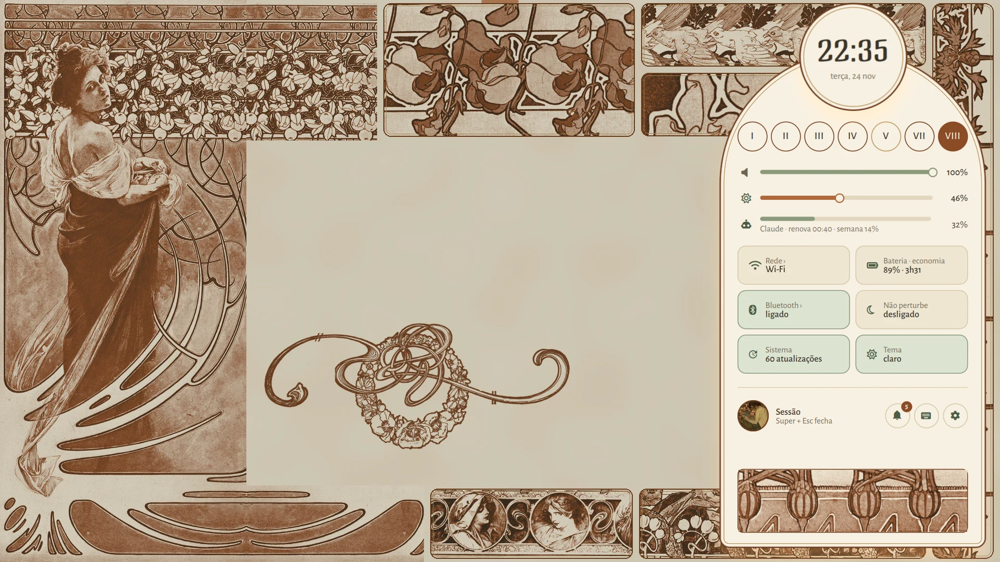
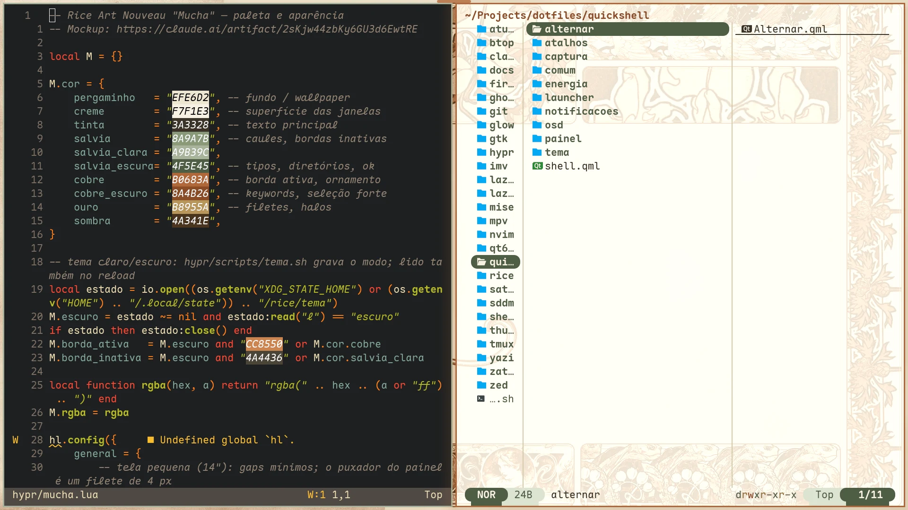
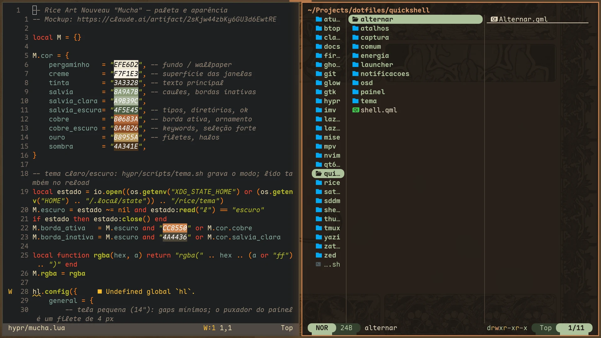
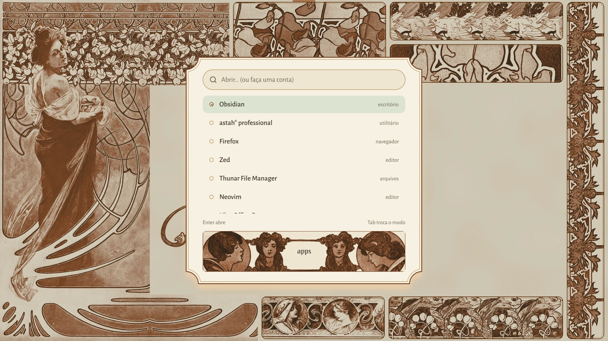
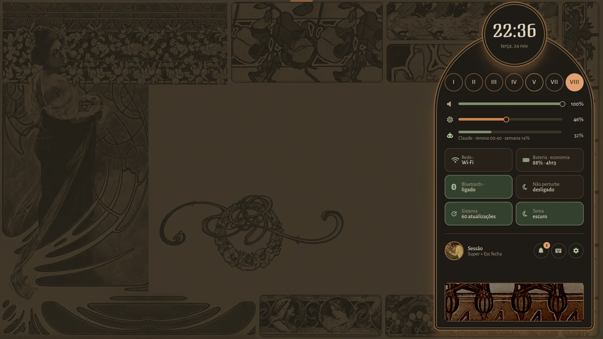

<div align="center">

# Mucha

**An Art Nouveau rice for Hyprland on Arch Linux, built from Alphonse Mucha's prints.**

Parchment, sage and copper by day, ink and embers by night. Every surface, from the
login screen down to the terminal, uses the same palette.




[English](#overview) · [Português](#em-português)

</div>

## Overview

| Day | Night |
| :---: | :---: |
|  |  |
|  |  |

The whole shell is written for this rice in [Quickshell](https://quickshell.org) (QML). There is
no Waybar, Rofi or Dunst. All of it shares the colour tokens in `quickshell/comum/Tema.qml`:

- **Panel** (`Super+Esc`): clock, workspaces in Roman numerals, volume, brightness,
  Wi-Fi, Bluetooth, battery, do-not-disturb, theme, pending updates, now playing.
- **Launcher** (`Super+D`): apps, a calculator, emoji and clipboard history. `Tab` switches mode.
- **Notifications**, a **volume/brightness OSD**, an **Alt+Tab** switcher with live previews,
  a **screenshot / recording** menu (`Print`) and a **keybinding cheat sheet** that reads
  `hyprctl binds`, so it never goes stale.
- **Day/night theme** (`Super+Shift+T`): automatic (dark from 19:30 to 7:00), light or dark.
  One switch recolours Hyprland, Quickshell, Ghostty, tmux, GTK, lazygit, yazi, btop and the wallpaper.

Also themed: hyprlock and an SDDM login screen with the same arched card, Ghostty, tmux, Neovim,
Firefox (`userChrome.css`), GTK 3/4, Qt 6, yazi, lazygit, lazydocker, btop, fzf, glow, atuin,
zathura, imv, mpv and satty.

## Install

> [!WARNING]
> These are personal dotfiles for a ThinkPad with a German keyboard and 1.5× scaling.
> Read the script before you run it, and try `--simular` (dry run) first.

```sh
git clone https://github.com/gengibrepower/dotfiles ~/Projects/dotfiles
cd ~/Projects/dotfiles
./instalar.sh --simular   # show what would happen
./instalar.sh             # packages → fonts → symlinks → shell/GTK → system services
```

The script is idempotent. Anything it would replace in `~/.config` is first moved to
`<name>.bak-<date>`. Use `--sem-pacotes` to skip packages and `--sem-sistema` to skip the
system steps (services, ufw, snapper, SDDM).

Your git e-mail lives outside the repo, in `~/.config/git/pessoal`:

```ini
[user]
	email = you@example.com
```

## Keybindings

`Super+ß` opens the full list. These are the most used:

| Keys | Action |
| --- | --- |
| `Super+Enter` / `Super+Alt+Enter` | Terminal / terminal in tmux |
| `Super+D` or `Super+Space` | Launcher |
| `Super+Esc` | Status panel |
| `Super+B` · `Super+O` · `Super+E` | Firefox · Obsidian · Thunar |
| `Super+Shift+Ä` | Morning setup: browser on 1, tmux on 2, Obsidian on 3 |
| `Super+G` · `Super+Shift+E` · `Super+Shift+D` | lazygit · yazi · lazydocker (floating) |
| `Super+1…0` / `Super+Shift+1…0` | Go to / move window to workspace |
| `Super+H J K L` | Move focus |
| `Super+W` · `Super+F` · `Super+Shift+V` | Close · fullscreen · float |
| `Super+C` / `V` / `X` · `Super+Ctrl+V` | Copy / paste / cut · clipboard history |
| `Super+.` · `Super+Ctrl+C` | Emoji · calculator |
| `Print` · `Shift+Print` | Capture menu · capture area |
| `Super+Shift+T` | Theme: auto → light → dark |
| `Super+Shift+P` | Projector: extend → mirror → external only |
| `Super+Ctrl+L` · `Super+Shift+U` | Lock · update the system |

## Layout

| Path | What |
| --- | --- |
| `hypr/` | Hyprland (Lua config), hyprlock, hypridle, hyprpaper, scripts (theme, capture, projector, lid, updates) |
| `quickshell/` | Panel, launcher, notifications, OSD, Alt+Tab, capture, cheat sheet, theme |
| `rice/` | Wallpapers and ornaments, plus generators (`gen/noite.py` derives every night palette) |
| `sddm/` | Login theme and its installer |
| `nvim/` | Neovim on `vim.pack`, no Mason. LSPs come from pacman |
| `ghostty/` `tmux/` `shell/` | Terminal, multiplexer, bash additions (fzf, zoxide, helpers) |
| `gtk/` `qt6ct/` `firefox/` | Toolkit and browser theming |
| `yazi/` `lazygit/` `lazydocker/` `btop/` `glow/` `atuin/` `zathura/` `imv/` `mpv/` `satty/` `thunar/` `zed/` | App configs and themes |
| `claude/` | Claude Code status line that feeds the panel's usage meter |
| `instalar.sh` | Installer |

## Credits

- Artwork: **Alphonse Mucha** (1860–1939). The prints are in the public domain.
- Fonts: [Federant](https://fonts.google.com/specimen/Federant) and
  [Alegreya Sans](https://fonts.google.com/specimen/Alegreya+Sans) (SIL Open Font License),
  [Maple Mono](https://github.com/subframe7536/maple-font) (OFL).
- Built on [Hyprland](https://hypr.land) and [Quickshell](https://quickshell.org).

## License

The code and configs are under the [MIT License](LICENSE). The bundled fonts keep their own
license (OFL), and Mucha's artwork is in the public domain.

---

## Em português

Rice Art Nouveau para Hyprland no Arch Linux, feito a partir das pranchas do Alphonse Mucha.
Painel, launcher, notificações, OSD, Alt+Tab, captura e lista de atalhos são todos feitos em
Quickshell, e um tema dia/noite recolore o sistema inteiro de uma vez. Para instalar, rode
`./instalar.sh --simular` pra ver o que ele faria e depois `./instalar.sh`. Seu e-mail do git
fica fora do repo, em `~/.config/git/pessoal`. Comentários e commits estão em português.
